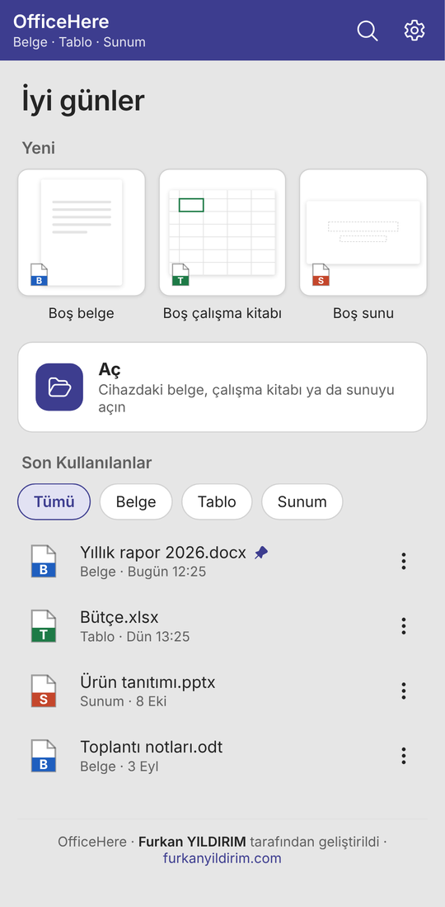
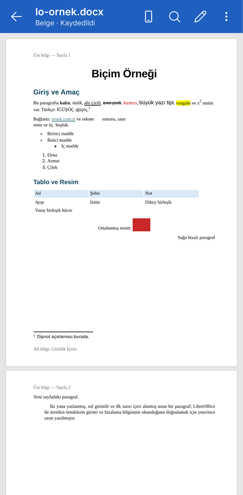
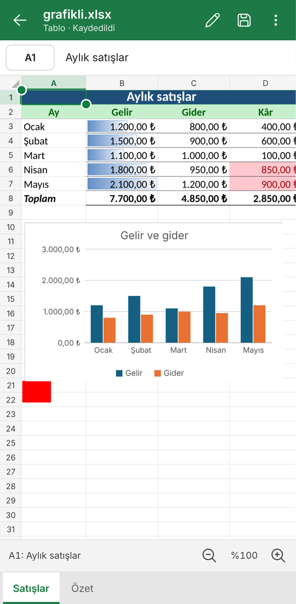
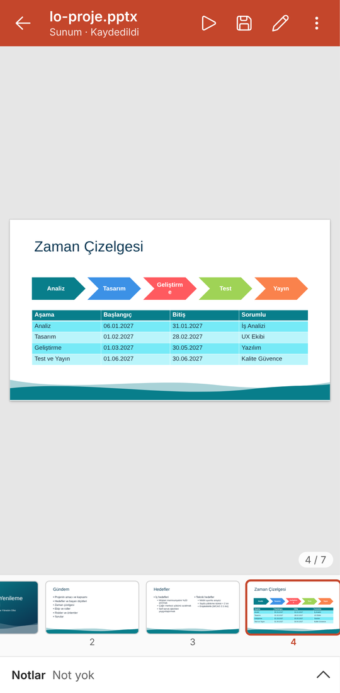
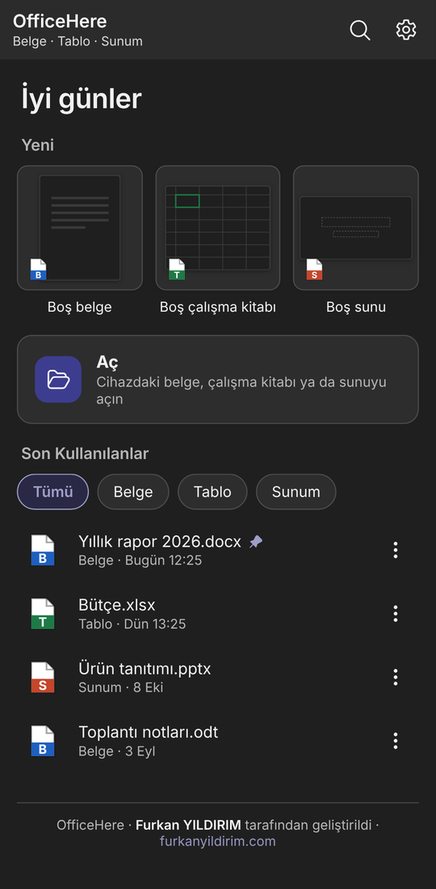
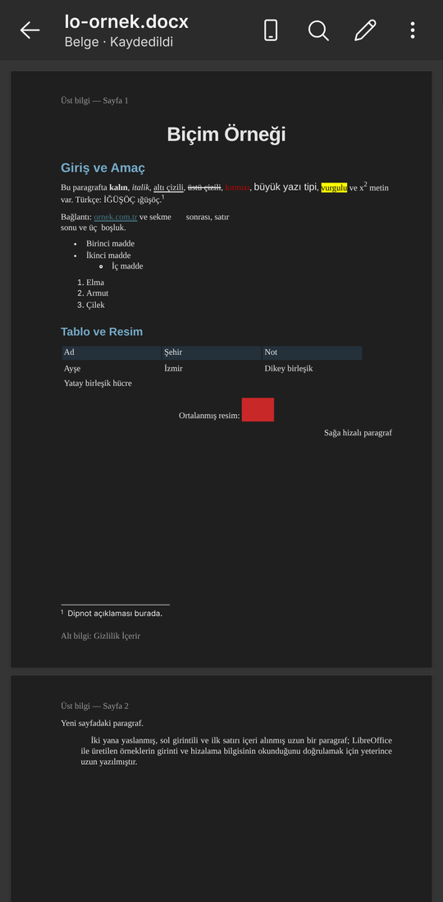
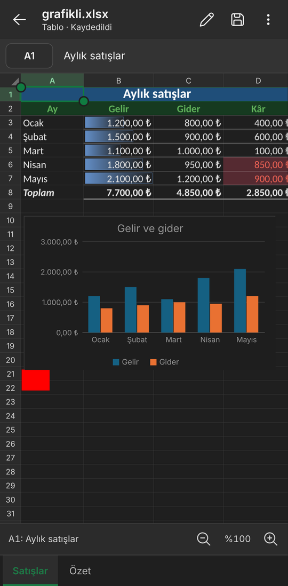
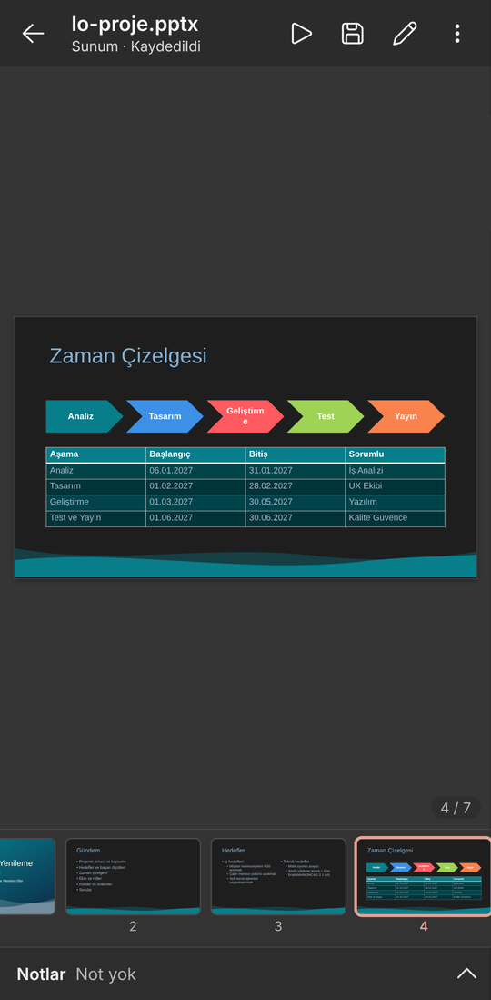

<div align="center">


# OfficeHere Mobil

**Açık kaynak, Türkçe ofis paketi — telefonunuzda.**
Belge, Tablo ve Sunum; masaüstü [OfficeHere](https://github.com/fyildirim-debug/officehere) ile aynı
dosya desteği ve aynı tasarım, dokunmatik ekran için yeniden düzenlenmiş hâliyle.

[İndir](https://github.com/fyildirim-debug/officeheremobile/releases) ·
[Hukuki çerçeve](HUKUKI.md) ·
[Geliştirme](docs/GELISTIRME.md)

</div>

<table>
<tr>
<td></td>
<td></td>
<td></td>
<td></td>
</tr>
<tr>
<td></td>
<td></td>
<td></td>
<td></td>
</tr>
</table>

## Ne yapar?

| Uygulama | Açar | Kaydeder |
| --- | --- | --- |
| **Belge** | `.docx` `.docm` `.dotx` `.dotm` `.doc` `.odt` `.ott` `.rtf` `.md` `.txt` `.html` | `.docx` `.odt` `.rtf` `.md` `.txt` `.html` |
| **Tablo** | `.xlsx` `.xlsm` `.xltx` `.xltm` `.xls` `.ods` `.ots` `.csv` `.tsv` | `.xlsx` `.ods` `.csv` `.tsv` |
| **Sunum** | `.pptx` `.pptm` `.potx` `.potm` `.ppsx` `.ppsm` `.ppt` `.odp` `.otp` | `.pptx` `.odp` `.ppsx` `.potx` |

Eski biçimler (`.doc`, `.xls`, `.ppt`) okunur; kaydedince `.docx`/`.xlsx`/`.pptx` olur.

Mobilde amaç belgeleri **eksiksiz görüntülemek** ve **hızlı düzeltmeler** yapmaktır:

- **Belge:** sayfa görünümü ve ekrana akan mobil görünüm, yakınlaştırma; kalın/italik/altı çizili,
  yazı tipi, boyut ve renk, vurgu, hizalama, listeler, girinti, stiller, bul ve değiştir, sözcük sayısı.
- **Tablo:** dokunmatik ızgara (kaydırma, iki parmakla yakınlaştırma, aralık seçimi), formül çubuğu,
  Türkçe işlev adlarıyla formüller (`=TOPLA`, `=EĞER`…), Otomatik Toplam, temel biçim, sayı biçimleri,
  satır/sütun/sayfa işlemleri, bul, bölmeleri dondur.
- **Sunum:** slayt görünümü ve küçük resimler, kaydırarak gezinme, geçiş ve animasyonlu slayt gösterisi,
  konuşmacı notları, metin kutularında yazma ve biçimleme, slayt ekle/çoğalt/sil/taşı/gizle.
- Tablolar, resimler, grafikler, şekiller, SmartArt ve denklemler masaüstündeki gibi çizilir; mobilde
  yalnız görüntülenir.
- Geri al/yinele, kaydedilmemiş değişiklik uyarısı, paylaş, farklı kaydet.

## Tema

Sistem (varsayılan), Açık (Renkli), Açık (Beyaz), Koyu Gri ve Siyah. **Koyu temada belge sayfaları,
tablo hücreleri, grafikler ve beyaz zeminli slaytlar da ekranda koyu gösterilir**; yazılar okunur
kalacak şekilde açılır, belirgin renkler ve resimler korunur. Kaydedilen dosya ve slayt gösterisi
etkilenmez.

## Android

- "Birlikte aç" ve "Gönder": dosya yöneticisinden, e-posta ya da mesajlaşma uygulamalarından gelen
  belgeler doğrudan açılır.
- Açılan belge aynı konuma kaydedilir; yeni belgede konum sorulur.
- Hesap, internet bağlantısı ya da depolama izni gerekmez; reklam ve veri toplama yoktur.
- Android 7.0 (API 24) ve üstü.

## Geliştirme

```bash
git clone --recurse-submodules https://github.com/fyildirim-debug/officeheremobile
cd officeheremobile
pnpm install
pnpm dev            # tarayıcıda http://localhost:5180
pnpm typecheck && pnpm test && pnpm e2e
pnpm android:debug  # android/app/build/outputs/apk/debug/app-debug.apk
```

Masaüstü OfficeHere kodu `vendor/officehere` alt modülünden olduğu gibi kullanılır: biçim
okuyucu/yazıcıları, çizim, formül motoru ve tasarım belirteçleri iki uygulamada ortaktır.
Ayrıntılar: [docs/GELISTIRME.md](docs/GELISTIRME.md).

## Lisans

MIT © Furkan YILDIRIM · [furkanyildirim.com](https://furkanyildirim.com)

OfficeHere bağımsız bir açık kaynak projesidir. Üçüncü taraf bileşenlerin lisansları uygulamada
**Ayarlar › Üçüncü taraf yazılım bildirimleri** altında yer alır.
